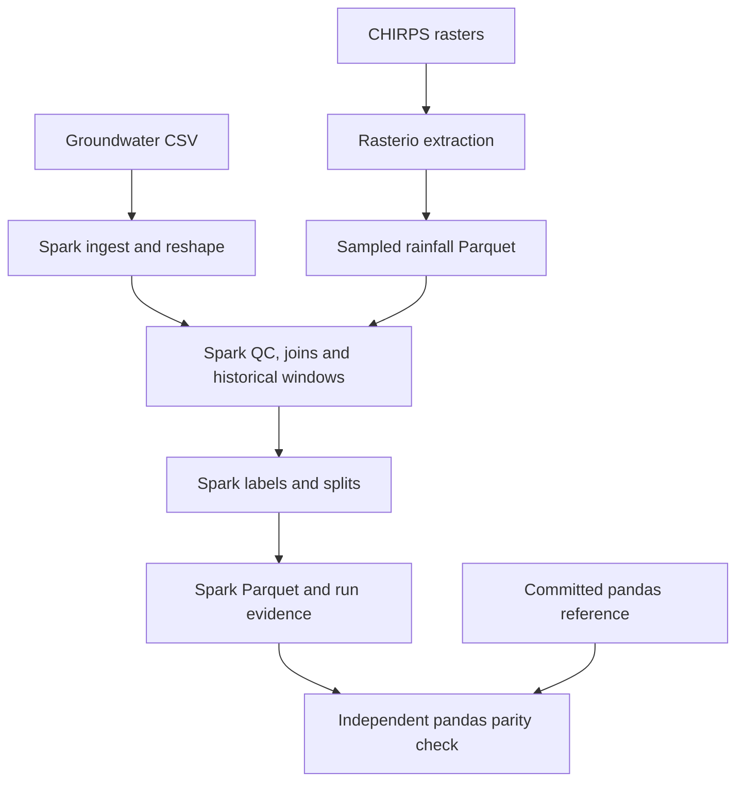

# Spark preprocessing

## Architecture



## What changed

The default pipeline now performs substantive preprocessing with PySpark rather than
running pandas and demonstrating Spark on finished data. Run `bash scripts/run_all.sh`
after installing `requirements-spark.txt` and Java 17. It executes `scripts/run_spark.py`
and the Spark-specific tests. The older pipeline remains an explicitly named pandas
reference: `bash scripts/run_pandas_reference.sh`, or `GW_ENGINE=pandas bash scripts/run_all.sh`.

New outputs are under `processed/spark/`, preserving the committed pandas tables for
independent validation. Point modeling code at the new feature and split directories
after parity has been checked. Generated historical figures and methods describe the
pandas baseline until they are regenerated or adapted to the new output paths; this
migration does not silently relabel those old artifacts as Spark-produced evidence.

## Engine responsibilities

| Work | Engine |
|---|---|
| Read groundwater CSV and cast fields | Spark CSV reader and DataFrame expressions |
| Create surrogate well IDs | Spark SHA-1 and string expressions |
| Wide-to-long monitoring rounds | Spark array/struct/explode |
| Missing values, names, duplicates and QC flags | Spark expressions and grouped aggregates |
| Join preceding rainfall months | Spark explode, equality joins and grouped sums |
| Past-only seasonal means, SDs, counts and groundwater lags | Spark ordered windows |
| Rainfall normals and monsoon deviations | Spark windows and joins |
| Stress labels | Spark conditional expressions |
| Extension matching and exclusions | Spark joins, null-safe comparisons and masked windows |
| Chronological/state splits and coverage rules | Spark joins and aggregates |
| State-partitioned Parquet | Spark DataFrame writer |
| Exact median/MAD, rolling statistics, Theil-Sen and Student-t transform | Small Python UDFs on Spark executors |
| Extract precipitation from global GeoTIFF grids | Existing Rasterio downloader, a separate acquisition step |
| Compare with historical pandas outputs | Optional pandas validation oracle, outside processing |

There is no `.toPandas()` or full-table `.collect()` in the preprocessing implementation.
Only small state lists and grouped report summaries reach the driver. A Python UDF is
not a driver-side pandas pipeline: Spark invokes it on executor tasks. These specialised
UDFs do add Python overhead and are disclosed rather than represented as pure Spark SQL.

The pipeline consumes committed sampled CHIRPS tables. The original download/extraction
scripts need not be re-run for normal reproduction. A warehouse, Hive metastore or HDFS
cluster is not required. Spark reads local Parquet files directly in the supplied setup.

## Temporal rules preserved

- A seasonal baseline uses only earlier readings from the same well and season.
- Expanding windows end at row −1; the current observation is excluded.
- Five earlier non-missing same-season readings are required. The sample SD has a 0.10 m floor.
- Rolling baselines use the latest ten earlier non-missing readings, requiring five.
- Trend uses the previous five calendar years of the same season, requiring four points.
- Rainfall contribution months end at M−1. Any missing contributing month makes a window NULL.
- Extension zero placeholders retain their stored values but are masked from all history windows.
- Current depth/anomaly/stress/change columns remain targets, not historical prediction inputs.
- Full-record robust flags, full-period completeness and no-series flags remain descriptive.

The input is still a published curated cohort whose authors used full-period QC and
future completeness to select wells. Switching computation engines does not make that
upstream selection causal. Sequential test features also use earlier test-period readings;
this supports monitoring, not a multi-year forecast issued once at the train cutoff.

## Intentional correction

The pandas reference's `gw_max_to_date_m` and `gw_min_to_date_m` return NaN after a missing
previous round, even if older observations exist. Spark's past-only `max`/`min` windows
retain the deepest/shallowest known earlier reading. This fixes the documented semantics.
The parity checker identifies these NULL-to-known-value corrections separately and rejects
other differences. It does not silently ignore whole columns. Scientific labels do not use
these extrema, so this correction should not change labels or evaluation eligibility.

## Nulls, types and partitioning

Spark writes missing numerical values as NULL, not IEEE NaN. Ordinary readers expose these
as missing values. Categorical columns are Parquet strings rather than pandas categorical
metadata. The main table has 84 logical columns, including the directory-derived
`state_slug`; the extension replaces that partition column with `is_extension`, also 84.
Use (`well_id`, `date`) or (`well_id`, `period_label`) as keys.

State directories are storage partitions; Spark task partitions are an independent execution
detail. `execution_plan.txt` exposes the joins, windows and limited Python UDF nodes before
checkpoint truncation. `run_manifest.json` records the Spark version, actual master, stage list,
row/well/column counts, stress counts, eligibility counts and runtime. `spark_run.md` is the
readable report generated from that run. No saved results are fabricated in the notebook.

## Running locally, in Colab or on a cluster

```bash
python scripts/run_spark.py --master 'local[2]' --shuffle-partitions 8
python scripts/run_spark.py --main-only --output processed/spark-main
python -m pytest -q tests/test_spark_pipeline.py
python scripts/verify_spark_parity.py
```

Local execution requires a JVM and enough memory for the Spark driver and workers. Two local
cores are the conservative default. The application uses Spark distributed APIs, but a
successful `local[2]` run is not evidence of multi-node execution or superior speed on this
small dataset. For cluster deployment, make all input and output paths accessible to executors,
provide the same Python/SciPy environment and use a shared checkpoint filesystem. The current
runner uses a temporary local checkpoint directory and is therefore configured for one-host
reproduction; changing `--master` alone is not a complete cluster deployment.

If hostname resolution causes startup trouble in a container, set `SPARK_LOCAL_IP=127.0.0.1`
for local runs. Do not use that address for a remote cluster driver.

The new notebook runs Spark preprocessing by default and displays Spark schema, grouped
results and execution evidence. The old pandas/optional-Spark notebook remains a historical
reference and its executed outputs do not validate this migration.

## Validation

`tests/test_spark_pipeline.py` checks minimum history, exclusion of current and future
readings, missing-round extrema, extension-value masking, complete earlier rainfall windows
and stress boundaries. The independent parity tool joins on keys and compares every column
with numerical tolerances. It compares main, extension and shared split outputs against the
committed pandas results, exposing unexpected mismatches and documented extrema corrections.

Validated on the committed dataset with PySpark 3.5.3, Python 3.12 and Java 17,
using `local[2]` and eight shuffle partitions:

| Output | Rows | Columns | Unexpected differences |
|---|---:|---:|---:|
| Main, 2000–2022 | 253,828 | 84 | 0 |
| Extension, 2023–2024 | 22,072 | 84 | 0 |
| Shared splits | 275,900 | 12 | 0 |

Every column was compared; numeric tolerance was `atol=1e-7, rtol=1e-7`.
The separately verified extrema corrections affect 34,194 rows in each main
extrema column and 12,946 rows in each extension extrema column. All stress
categories, flags and split eligibility match the reference. Eligible counts
are train 104,437, validation 15,513, test 40,630 and extension 5,910.
The five Spark tests passed, including a real float32 rainfall rounding case.
Notebook code cells compile; the notebook has not been executed in Colab.

The 1/3/6-month rainfall sums preserve the reference's newest-first float32
Kahan summation using Spark higher-order array expressions. An ordinary
double-precision sum followed by a float cast is not equivalent. This avoids
propagating tiny rounding differences into rainfall deviations and z-scores.
